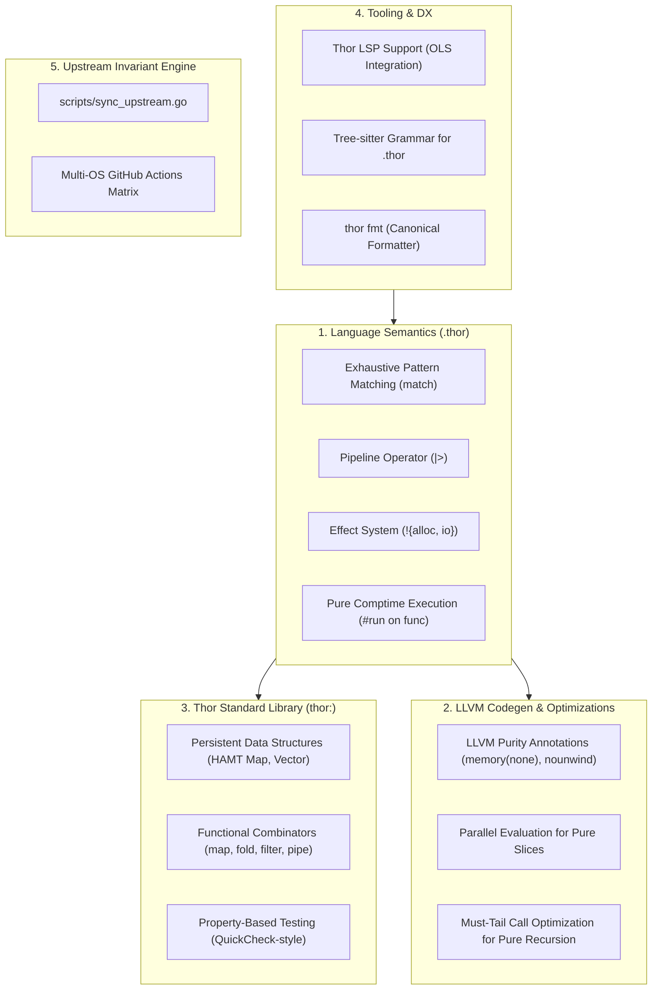

# Thor Engineering & Architecture Plans

This directory serves as the centralized repository for architectural designs, feature specifications, and strategic roadmaps for the **Thor Programming Language & Stack**.

---

## Catalog of Plans

| Document | Status | Scope & Purpose |
|---|---|---|
| [thor_stack_improvement_plan.md](file:///Users/prakash/github/Odin/plans/thor_stack_improvement_plan.md) | **Active / Roadmap** | Comprehensive 5-pillar strategic roadmap detailing LLVM purity codegen, the `thor:` standard library, extended syntax (`match`, `\|>`), tooling/LSP, and automated upstream tracking. |
| [thor_strict_separation_plan.md](file:///Users/prakash/github/Odin/plans/thor_strict_separation_plan.md) | **Implemented** | Architecture specification for strict C/C++ style separation between `.thor` and `.odin` files, preserving 100% zero-diff compatibility with upstream Odin `core:` and `vendor:`. |
| [thor_extension_plan.md](file:///Users/prakash/github/Odin/plans/thor_extension_plan.md) | **Implemented** | Initial architectural plan for extending the Odin compiler frontend with the Thor pure function dialect (`func`). |

---

## Strategic Improvement Roadmap Overview

For complete details, see [thor_stack_improvement_plan.md](file:///Users/prakash/github/Odin/plans/thor_stack_improvement_plan.md).

---

## Phased Implementation Schedule

1. **Phase 1: LLVM Purity Optimization Lowering**
   - Emit `memory(none)` / `readnone`, `willreturn`, and `nounwind` attributes for `func` in `src/llvm_backend_proc.cpp`.
   - Enable aggressive LLVM Loop Invariant Code Motion (LICM) and Common Subexpression Elimination (CSE).

2. **Phase 2: Thor Standard Library Expansion (`thor:`)**
   - Build `thor:functional` (`map`, `filter`, `fold`, `compose`, `pipe`).
   - Build `thor:collections` (Bitmapped vector trie, Hash Array Mapped Trie).

3. **Phase 3: Syntax Innovations**
   - Expression-oriented `match` with guaranteed exhaustiveness checking.
   - Pipeline operator `\|>`.

4. **Phase 4: Tooling & Developer Experience**
   - Tree-sitter grammar for `.thor` files.
   - Language Server (OLS) integration with live purity diagnostics.

5. **Phase 5: Automated Upstream Synchronization**
   - `scripts/sync_upstream.go` tracking `odin-lang/Odin` with zero-diff validation.
