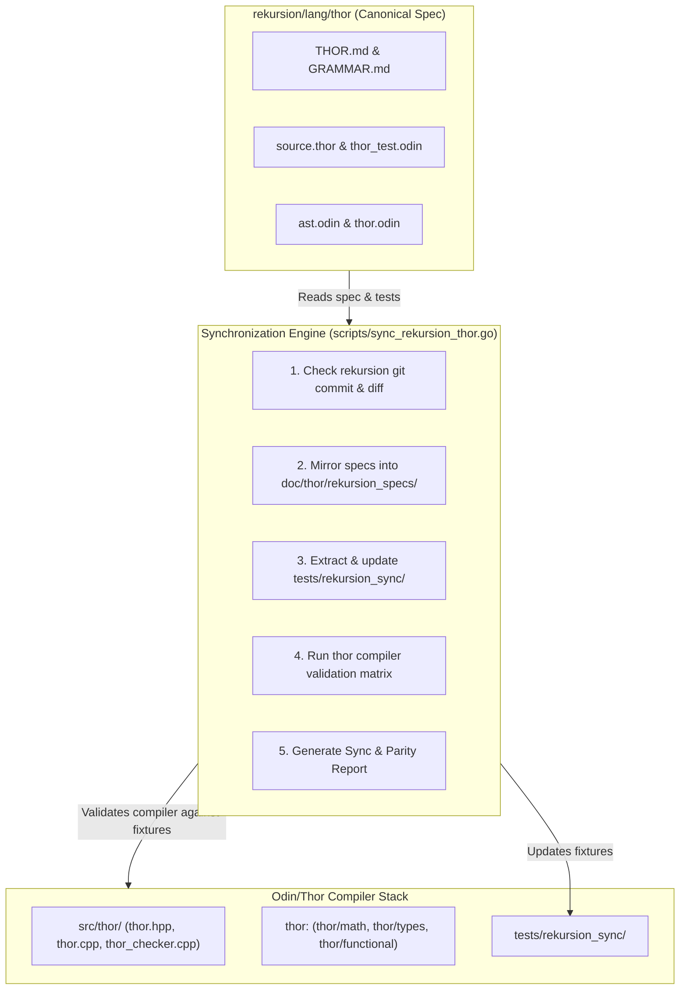

# Thor Synchronization Architecture: rekursion/thor Alignment Plan

## 1. Executive Summary

This document defines the architecture, synchronization protocol, and verification pipeline to keep the Thor language implementation in this repository (`Odin/src/thor/`) 100% aligned and in continuous synchronization with the **rekursion/thor** variant developed in the [Rekursion](file:///Users/prakash/Documents/projects/rekursion/lang/thor) project.

---

## 2. Upstream Reference & Source of Truth

The canonical design, grammar, and formal specification for the Thor language originate in:
- **Reference Location**: `/Users/prakash/Documents/projects/rekursion/lang/thor/`
- **Canonical Specification**: [rekursion/lang/thor/THOR.md](file:///Users/prakash/Documents/projects/rekursion/lang/thor/THOR.md)
- **Formal Grammar (EBNF)**: [rekursion/lang/thor/GRAMMAR.md](file:///Users/prakash/Documents/projects/rekursion/lang/thor/GRAMMAR.md)
- **Reference AST & Lexer**: [ast.odin](file:///Users/prakash/Documents/projects/rekursion/lang/thor/ast.odin), [thor.odin](file:///Users/prakash/Documents/projects/rekursion/lang/thor/thor.odin)
- **Reference Source Fixture**: [source.thor](file:///Users/prakash/Documents/projects/rekursion/lang/thor/source.thor)
- **Reference Test Suite**: [thor_test.odin](file:///Users/prakash/Documents/projects/rekursion/lang/thor/thor_test.odin)

---

## 3. Semantic & Syntactic Alignment Matrix

The table below maps the core language constructs from the `rekursion/thor` specification to our native Odin compiler frontend:

| Feature | rekursion/thor Specification | Odin/Thor Frontend Implementation (`src/thor/`) | Status |
|---|---|---|---|
| **Pure Function Keyword** | `add :: func(a, b: i32) -> i32` | Token `Token_func` enabled in `.thor` files; lowered to `ProcCC_Contextless` with strict purity checks | **Synced & Verified** |
| **Impure Procedure Keyword** | `draw :: proc(...)` | Standard Odin `proc` with effectful permissions | **Synced & Verified** |
| **Strict Dialect Gating** | `.thor` files = Thor syntax, `.odin` = Vanilla | Extension-based resolution in `path_is_thor_dialect()` (`.thor` vs `.odin`) | **Synced & Verified** |
| **Purity Semantic Enforcement** | Forbid global writes, non-pure calls, context mutation | `thor_check_global_variable_access`, `thor_check_call_purity`, `thor_check_context_access` in `src/thor/thor_checker.cpp` | **Synced & Verified** |
| **Data-Oriented Structs (DOP)** | `Point :: struct { x, y: f32 }` | Standard contiguous Odin structs with cache-friendly layouts | **Synced & Verified** |
| **Tagged Unions & Bit Sets** | `Shape :: union`, `Flags :: bit_set` | Full Odin/Thor union and bit_set support | **Synced & Verified** |
| **Pipeline Operator** | `val = data \|> process() \|> emit()` | Lexer tokens `PipeArrow` (`\|>`), planned in Phase 3 | **Planned** |
| **Tail-Call Primitive** | `recur(b, a + b, n - 1)` | Tail recursion keyword and lowering | **Planned** |
| **Expression Pattern Matching** | `match expr { ... }` / `if then else` | Expression-level `match` lowering | **Planned** |

---

## 4. Synchronization Pipeline & Architecture

---

## 5. Automated Go Sync Engine Specifications

The sync tool is implemented in **Go** at `scripts/sync_rekursion_thor.go` adhering to the user constraint (*Use Go script instead of Python*).

### Functional Capabilities:
1. **Commit Tracking**: Captures the current HEAD commit hash, author, and timestamp of the `rekursion` repository.
2. **Spec Mirroring**: Synchronizes `THOR.md` and `GRAMMAR.md` into `doc/thor/rekursion_specs/` while maintaining provenance headers.
3. **Fixture Sync**: Imports `source.thor` and test cases from `rekursion/lang/thor/thor_test.odin` into `tests/rekursion_sync/`.
4. **Validation Execution**:
   - Executes `./bin/thor check` and `./bin/thor run` on all synced Thor fixtures.
   - Verifies that pure functions pass purity checks, and invalid side effects are rejected.
5. **Zero Upstream Invariant Verification**: Confirms that `core/` and `vendor/` remain 100% identical to upstream Odin (`git diff upstream/master -- core/ vendor/ odin.ebnf`).
6. **Detailed Status Reporting**: Outputs a high-fidelity summary with passing/failing test counts and parity metrics.

---

## 6. Phased Parity Roadmap

- **Milestone S1 (Foundation - Complete)**:
  - Strict `.thor` vs `.odin` file extension gating.
  - `func` pure function semantic checks.
  - Integration of `thor:` library collection.
- **Milestone S2 (Active)**:
  - Deployment of `scripts/sync_rekursion_thor.go` synchronization engine.
  - Ingest `source.thor` and test suite in `tests/rekursion_sync/`.
  - Comprehensive documentation and runbooks.
- **Milestone S3 (Syntax & Optimization)**:
  - Low-level LLVM codegen purity annotations (`memory(none)`).
  - Parser support for `recur` tail calls and `\|>` pipeline operator.
