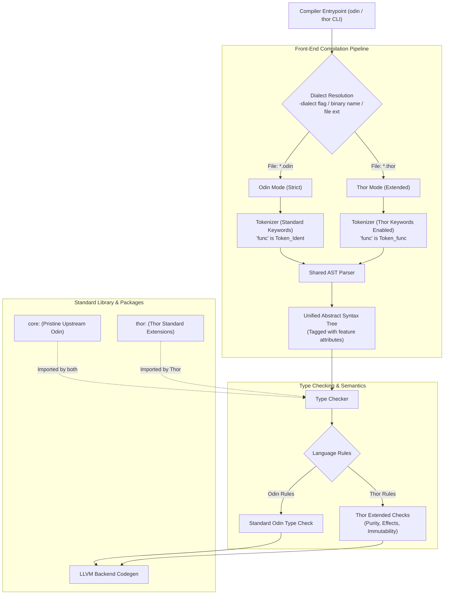

# Extending Odin with Thor Language (Non-Breaking Upstream Strategy)

## 1. Executive Summary & Problem Analysis

### 1.1 The Challenge
Extending the Odin programming language with a superset or sister dialect—**Thor** (e.g., adding pure functions with `func`, effect systems, immutability, pattern matching, or custom semantics)—creates high friction with upstream Odin (`odin-lang/Odin`):
1. **Keyword Collisions**: Introducing keywords like `func` into the global tokenizer immediately breaks existing Odin code in `core:` and `vendor:` that use `func` as an identifier (e.g., parameter names in `core/c/libc/signal.odin`, `stdlib.odin`, `threads.odin`).
2. **Standard Library Pollution**: Modifying `core:` files to rename identifiers (`func` -> `fn`) diverges from upstream, making git merges and rebases from `upstream/master` painful or impossible.
3. **Language Invariants**: Upstream Odin maintains strict design guidelines; ad-hoc changes to the parser and checker risk breaking language assumptions or causing silent regressions in standard Odin code.

### 1.2 The Goal
Enable **Thor** as a first-class language dialect within the Odin compiler engine such that:
- **Zero-Diff Upstream Core**: `core/` and `vendor/` remain 100% untouched and identical to upstream Odin.
- **Dialect Isolation**: Standard `.odin` files compile strictly according to Odin's language specification; Thor-specific features are only active when explicitly requested or in `.thor` files.
- **Bi-directional Interoperability**: Thor code can seamlessly import and call standard Odin packages (`core:fmt`, `vendor:wgpu`, user Odin code), and Odin code can call Thor procedures.
- **Frictionless Upstream Tracking**: Upstream Odin updates can be merged or rebased cleanly without conflicts in core libraries or standard syntax.

---

## 2. Architectural Blueprint



---

## 3. Core Architectural Components

### 3.1 Dialect-Aware Tokenizer (Solving Keyword Collisions)
Instead of globally registering `func` as a keyword in `keyword_hash_table`, the tokenizer must be dialect-aware:

- **Dialect Enum**:
  ```cpp
  enum LanguageDialect : u8 {
      Dialect_Odin = 0,
      Dialect_Thor = 1,
  };
  ```
- **Contextual / Dialect-Gated Lookup**:
  - The `Tokenizer` struct stores `LanguageDialect dialect;`.
  - When tokenizing an identifier matching `"func"`:
    - If `tokenizer.dialect == Dialect_Thor`: emit `Token_func`.
    - If `tokenizer.dialect == Dialect_Odin`: emit `Token_Ident` with string `"func"`.
  - This immediately eliminates collisions in `core/c/libc/signal.odin`, `stdlib.odin`, `threads.odin`, allowing upstream `core` to remain completely untouched.

### 3.2 File Extension & Package Model
- **Extensions Supported**:
  - `.odin` files: Strict Odin dialect by default.
  - `.thor` files: Thor dialect by default.
- **Directory / Package Scanning**:
  - Update `parser.cpp` and `build_settings.cpp` to recognize both `.odin` and `.thor` extensions.
  - A package can be:
    - Pure Odin package (`*.odin`).
    - Pure Thor package (`*.thor`).
    - Mixed package (with clear rules or file-level dialect tags `#+dialect thor` / `#+dialect odin`).
- **Compiler Invocations**:
  - Binary dispatch: If invoked as `thor`, default project dialect is Thor; if `odin`, default is Odin.
  - Explicit flag: `-dialect:odin` or `-dialect:thor` (or `-lang:thor`).

### 3.3 Parser & AST Isolation
- Use existing Odin AST node structures with extension flags rather than duplicating node types:
  - `AstNode_ProcType`: carries `bool is_func` or `u32 language_flags`.
  - `AstNode_ProcLit`: inherits the `is_pure` / `is_func` property.
- When parsing `.odin` files, parsing `func` as a procedure declaration produces a syntax error or warning unless in Thor dialect mode.
- Parser error messages and diagnostics respect the source file dialect.

### 3.4 Type Checker & Semantic Verification
- Thor-specific validations (such as verifying pure functions) should be encapsulated in dedicated helper routines (e.g., `thor_check_pure_func(...)`):
  - Pure function restrictions:
    - No mutable global state access.
    - No calls to impure `proc` (only calls to `func` or procs marked contextless/pure).
    - No I/O or side-effects unless explicitly permitted via an effect/capability system.
    - Deterministic argument handling.
- Upstream type checking logic for `proc` remains intact without branch degradation or unexpected side effects for standard Odin code.

### 3.5 Standard Library & Runtime Strategy
- **`core/` and `vendor/`**: Kept 100% identical to upstream `odin-lang/Odin`. Zero modifications permitted.
- **`thor/`**: New top-level directory for Thor-specific standard library packages, accessible via `import "thor:xxx"`.
- **Runtime Intrinsics**: Any new runtime hooks for Thor live in `base/runtime/thor_*.odin` or isolated in a `thor` runtime layer.

---

## 4. Git & Upstream Synchronization Strategy

### 4.1 Branching Topology
```
upstream/master (odin-lang/Odin)
       │
       ▼
   upstream-sync (clean mirror branch)
       │
       ▼
   master / thor-dev (Thor extensions layered on top)
```

### 4.2 Code Isolation Invariants
1. **Never edit files in `core/` or `vendor/`** for Thor language features.
2. All compiler diffs in `src/` should be cleanly commented with `// THOR EXTENSION:` or organized into dedicated translation units:
   - `src/thor_dialect.hpp` / `src/thor_dialect.cpp`
   - `src/thor_checker.cpp`
3. Git commits for upstream rebases:
   - Run `git rebase upstream/master` regularly. Because `core/` has zero changes, rebase conflicts will be limited strictly to compiler internals in `src/`.

---

## 5. Phased Implementation Roadmap

### Phase 1: Revert Core & Implement Dialect-Aware Lexer
- **Action 1.1**: Revert changes in `core/c/libc/signal.odin`, `stdlib.odin`, `threads.odin`, and `core/sys/posix/signal_libc.odin`.
- **Action 1.2**: Add `LanguageDialect` to compiler settings and `Tokenizer`.
- **Action 1.3**: Make `Token_func` conditional on `dialect == Dialect_Thor`.
- **Verification**: Run `build_odin.sh` and compile upstream `core:` tests to confirm 100% clean build without any core modifications.

### Phase 2: File Extension & Build System Support
- **Action 2.1**: Update `src/build_settings.cpp` and `src/parser.cpp` to recognize `.thor` files alongside `.odin` files.
- **Action 2.2**: Add CLI flag `-dialect:odin|thor|auto`.
- **Action 2.3**: Support binary naming alias (`thor` executable symlink or build target).
- **Verification**: Compile a package with both `.odin` and `.thor` files and verify proper dialect assignment per file.

### Phase 3: Modular Parser & Purity Checker
- **Action 3.1**: Isolate `func` parsing and pure function AST validation into clean helper methods.
- **Action 3.2**: Implement strict purity checking (no global mutation, context-free, calling restrictions).
- **Action 3.3**: Ensure clear diagnostics for purity violations in `.thor` files.
- **Verification**: Run `tests/internal/test_pure_func.odin` (renamed to `test_pure_func.thor`).

### Phase 4: Thor Standard Library & Interoperability
- **Action 4.1**: Create `thor/` root collection for Thor-specific libraries.
- **Action 4.2**: Verify cross-importing:
  - Thor calling Odin `core:fmt` and `vendor:wgpu`.
  - Odin calling pure `func` definitions exported from Thor packages.
- **Verification**: End-to-end tests for mixed-language compilation.

### Phase 5: Automation, CI & Upstream Sync Tooling
- **Action 5.1**: Write a Go script (`scripts/sync_upstream.go`) to automate pulling from `upstream/master`, checking `core/` integrity, and running both test suites.
- **Action 5.2**: Create `README.md` documenting Thor features, dialect differences, and build instructions.
- **Action 5.3**: Commit all improvements to git following user project rules.

---

## 6. Success Metrics & Verification Checklist

| Metric | Target | Verification Method |
|---|---|---|
| Upstream `core/` Diff | Exactly 0 lines changed | `git diff upstream/master -- core/ vendor/` |
| Vanilla Odin Compatibility | 100% pass on all upstream tests | `./run_tests.sh` |
| Thor `func` Functionality | Pure function semantics verified | `./odin check tests/internal/test_pure_func.thor` |
| Keyword Safety | `func` usable as identifier in `.odin` files | Compiles `core/c/libc` without error |
| Rebase Cleanliness | Frictionless rebase on `upstream/master` | Automated Git rebase smoke test |
