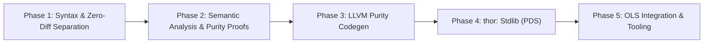

# Thor Compiler & Language Dialect: Detailed Multi-Phase Execution Plan

> **Location:** [`odin/plans/thor_multi_phase_execution_plan.md`](file:///Users/prakash/Documents/Repositories/odin/plans/thor_multi_phase_execution_plan.md)  
> **Repository:** [`git@github.com:satyaprakashere/Odin.git`](file:///Users/prakash/Documents/Repositories/odin)  
> **Status:** Active Multi-Phase Specification  
> **Target Timeline:** Q4 2026 – Q2 2027

---

## 📖 Canonical Literature Ingestion & Theoretical Foundations

This plan ingests primary compiler construction and type theory literature from the repository library:

1. **Andrew W. Appel**: *Modern Compiler Implementation in ML* ([`books/Computer Science & Programming`](file:///Users/prakash/Documents/Repositories/books/Computer%20Science%20%26%20Programming/Modern%20Compiler%20Implementation%20in%20ML%20-%20Andrew%20W.%20Appel.epub))
   - **Applied Principle**: Explicit distinction between pure functional intermediate representations and imperative lowering. Translation of pure pattern matching into optimal decision trees.
2. **Alfred Aho, Monica Lam, Ravi Sethi, Jeffrey Ullman**: *Compilers: Principles, Techniques, and Tools* ([`pdfs/Compilers & Runtime Systems`](file:///Users/prakash/Documents/Repositories/pdfs/Compilers%20%26%20Runtime%20Systems/Compilers%20-%20Principles%20Techniques%20and%20Tools%20by%20Alfred%20Aho%20Monica%20Lam%20Ravi%20Sethi%20Jeffrey%20Ullman%20-%20Second%20Edition.pdf))
   - **Applied Principle**: Type checking, syntax-directed translation schemes, and SSA form generation without control-flow leaks.
3. **LLVM Project**: *LLVM Bitcode Introduction & Language Reference* ([`pdfs/Compilers & Runtime Systems/LLVM Bitcode Introduction.pdf`](file:///Users/prakash/Documents/Repositories/pdfs/Compilers%20%26%20Runtime%20Systems/LLVM%20Bitcode%20Introduction.pdf))
   - **Applied Principle**: Function-level attribute tagging (`memory(none)`, `nounwind`, `willreturn`, `speculatable`) to enable interprocedural dead-code elimination, common subexpression elimination, and loop-invariant code motion for pure functions.

---

## ⚡ Multi-Phase Execution Roadmap

### Phase 1: Zero-Diff Upstream Separation & Lexer Gating (Q4 2026)
- **Objective**: Maintain strict isolation between `.thor` and `.odin` files with zero modifications to upstream `core:` and `vendor:`.
- **Implementation**:
  - Extend Odin compiler lexer and parser in `src/parser.cpp` to recognize `func` as a pure function keyword exclusively when compiling `.thor` compilation units.
  - Reject mutable assignments (`:=`, `+=`, `*=`) inside pure `func` scopes, requiring expression-based returns.
- **Verification**: `git diff upstream/master -- src/core src/vendor` must remain exactly 0 lines.

### Phase 2: Semantic Analysis & Effect Boundary Invariants (Q4 2026)
- **Objective**: Enforce compiler-checked purity and effect restrictions.
- **Implementation**:
  - Pure functions cannot invoke procedures declared with `proc` unless marked with explicit compiler override attributes.
  - Ban global variable access, ambient heap allocations (without scoped allocators), and I/O syscalls inside `func`.
  - Type-check pipeline operator expressions: `x |> f |> g` lowers to `g(f(x))`.
- **Verification**: `./odin check tests/thor/purity_violation.thor` correctly rejects side-effects with informative error diagnostics.

### Phase 3: LLVM Purity Attributes & High-Performance Codegen (Q1 2027)
- **Objective**: Instruct LLVM's optimizer to treat Thor pure functions as mathematical transformations.
- **Implementation**:
  - In `src/llvm_backend.cpp`, tag every pure `func` definition with LLVM attributes:
    `attributes #0 = { memory(none) nounwind willreturn speculatable }`.
  - Enable tail-call optimization (`musttail`) for recursive pure functions.
  - Auto-vectorize pure array transformations utilizing SIMD primitives without aliasing hazards.
- **Verification**: Inspect generated LLVM IR (`./odin build tests/thor -build-mode:llvm`) to confirm `memory(none)` attributes.

### Phase 4: Canonical Persistent Standard Library (`thor:`) (Q1 2027)
- **Objective**: Implement high-performance immutable data structures in native Thor.
- **Implementation**:
  - `thor:collections`: Persistent Hash Array Mapped Trie (HAMT) Map, Persistent Vector based on 32-way branching trees.
  - `thor:iter`: Pure combinators (`map`, `filter`, `fold`, `zip`, `take_while`).
  - `thor:testing`: QuickCheck-style property-based testing framework with automatic shrinkers.
- **Verification**: `./odin test tests/thor/pds_tests.thor` passes 10,000 generated randomized test cases.

### Phase 5: Language Server (OLS) & Developer Tooling (Q2 2027)
- **Objective**: First-class developer experience in Helix, VSCode, and AppRunner.
- **Implementation**:
  - Update OLS (Odin Language Server) to support `.thor` file extensions, provide hover docs for purity attributes, and autocompletion for pipelines.
  - Tree-sitter grammar generation for `.thor` syntax highlighting.
  - Formatter `thor fmt` enforcing canonical indentation and formatting.
- **Verification**: OLS reports zero syntax errors when opening Thor projects in Helix/VSCode.
