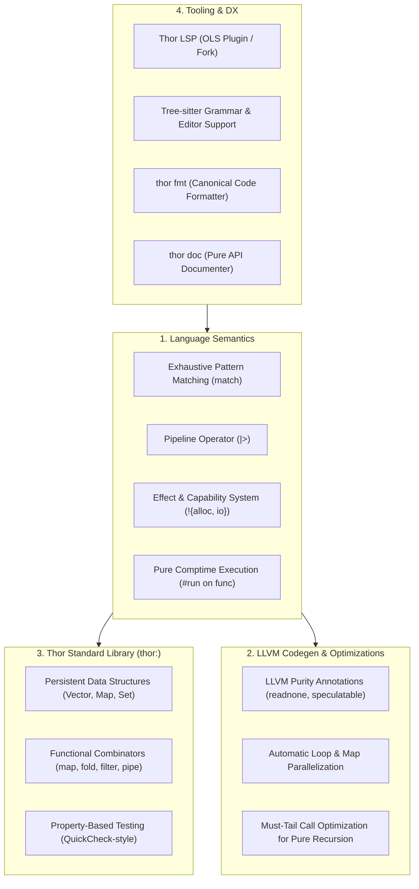
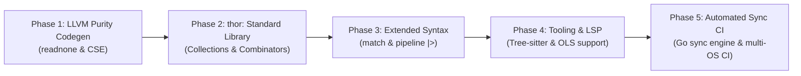

# Strategic Roadmap & Technical Plan: Elevating the Thor Language & Ecosystem

## 1. Executive Summary

Now that Thor features a **strict C/C++ style dialect separation** (`.thor` vs `.odin`), zero-diff upstream Odin compatibility, and a dedicated `thor:` library collection, Thor is positioned to evolve from a compiler dialect into a complete, high-performance programming stack.

This roadmap details actionable improvements across five core pillars:
1. **Language Semantics & Type System**: Pattern matching, pipeline operators, effect tracking, and compile-time evaluation.
2. **LLVM Backend Optimizations**: Leveraging purity for compiler transformations (CSE, vectorization, `readnone`).
3. **Thor Standard Library (`thor:`)**: Persistent immutable data structures, property-based testing, and functional algorithms.
4. **Tooling & Developer Experience (DX)**: LSP support, editor grammars, formatter, and package workflows.
5. **Infrastructure & Continuous Upstream Synchronization**: Automated Go-based upstream tracking and CI regression gates.

---

## 2. Comprehensive Pillar Architecture



---

## 3. Detailed Technical Pillars

### Pillar 1: Advanced Language Semantics (Exclusive to `.thor`)

#### 1.1 Exhaustive Pattern Matching (`match`)
While Odin uses `switch` and `#partial switch`, Thor can introduce an expression-oriented `match`:
```thor
result := match value {
    0             => "zero",
    1..=9         => "single digit",
    Point{x, y}   => fmt.tprintfln("point at (%d, %d)", x, y),
    _             => "other",
}
```
- **Guaranteed Exhaustiveness**: The compiler checks all enum tags, union variants, or ranges at compile time.
- **Expression Evaluation**: Can yield values directly into variables without boilerplate temporary assignment.

#### 1.2 Pipeline Operator (`|>`)
For clean, left-to-right data transformations without nested parentheses:
```thor
final_data := raw_input 
    |> clean_whitespace 
    |> parse_records 
    |> math.bubble_sort
```

#### 1.3 Effect & Capability System (`!{effect}`)
Pure `func` currently forbids all side effects. We can expand this with a fine-grained capability/effect system:
- `func(...) -> T`: 100% pure (no memory allocation, no I/O, no context, deterministic).
- `func(...) -> T ! {alloc}`: Pure computation that may allocate temporary scratch memory (e.g., dynamic arena).
- `func(...) -> T ! {io}`: May perform deterministic I/O.
- Procedures marked `proc` remain unconstrained.

#### 1.4 Guaranteed Compile-Time Execution (`#run`)
Because pure functions have no side effects and do not depend on machine state or globals, any `func` with constant arguments is a 100% safe candidate for compile-time execution (`#run`), eliminating runtime calculation costs entirely.

---

### Pillar 2: LLVM Backend Optimization Exploits

Because Thor guarantees at the AST/semantic level that a `func` is pure and contextless, the LLVM code generator can pass aggressive optimization hints that vanilla Odin `proc` cannot:

1. **LLVM Function Attributes**:
   - `memory(none)` (formerly `readnone`): Informs LLVM that the function reads only its arguments and never accesses global or heap memory.
   - `willreturn`: Function is guaranteed to terminate (when recursion/loops are bounded).
   - `speculatable`: The call can be speculatively executed or moved across conditional branches without causing traps.
   - `nounwind`: Guaranteed never to throw or raise exceptions.
2. **Aggressive Loop Invariant Code Motion (LICM)**:
   - LLVM can automatically hoist calls to pure `func` completely out of loops when the arguments are loop-invariant.
3. **Common Subexpression Elimination (CSE)**:
   - Duplicate calls `add(x, y) + add(x, y)` collapse into a single execution and a register reuse.
4. **Safe Auto-Parallelization**:
   - Because `func` has no data races or mutable state, calls over slices (`thor.parallel_map`) can be safely dispatched to thread pools without synchronization locks.

---

### Pillar 3: Thor Standard Library Expansion (`thor:`)

Expand the top-level `thor/` collection with native Thor packages:

1. **`thor:collections`**:
   - Persistent, copy-on-write immutable data structures:
     - `Persistent_Vector($T)`: Bitmapped vector trie with $O(\log_{32} n)$ inserts/lookups.
     - `Persistent_Map($K, $V)`: Hash Array Mapped Trie (HAMT).
     - `Persistent_Set($T)`.
2. **`thor:functional`**:
   - Generic higher-order combinators: `map`, `filter`, `fold_left`, `fold_right`, `zip`, `compose`, `pipe`.
3. **`thor:testing` (Property-Based Testing)**:
   - QuickCheck-style automated test generation: generate thousands of random inputs to verify mathematical invariants of pure functions automatically:
     ```thor
     @(test)
     prop_reverse_involutive :: func(t: ^testing.T) {
         testing.quick_check(t, func(s: []int) -> bool {
             return reflect.equal(reverse(reverse(s)), s)
         })
     }
     ```

---

## 4. Pillar 4: Tooling & Developer Experience (DX)

1. **Editor Support & Syntax Highlighting**:
   - **Tree-sitter Grammar**: Create `tree-sitter-thor` (or extend `tree-sitter-odin`) to parse `.thor` files, highlighting `func` and Thor keywords distinctly.
   - **VS Code Extension**: Register `.thor` file associations to inherit Odin grammar with Thor keywords enabled.
2. **LSP (Language Server Protocol) Integration**:
   - Extend the Odin Language Server (`ols`) to index both `.odin` and `.thor` files.
   - Auto-suggest `func` for pure functions, and surface real-time purity linting in the editor (e.g. highlighting global variable mutations inside a `func`).
3. **Thor CLI Tools**:
   - `thor fmt`: Built-in canonical code formatter for `.thor` files.
   - `thor doc`: Documentation generator that catalogs pure API functions with purity tags and performance complexity metadata.

---

## 5. Pillar 5: Continuous Upstream Synchronization Infrastructure

To ensure Thor never lags behind upstream `odin-lang/Odin` and never suffers merge breakages:

1. **Automated Upstream Sync Tool (`scripts/sync_upstream.go`)**:
   - A standalone Go script that:
     1. Fetches latest `upstream/master`.
     2. Verifies that `core/` and `vendor/` have 0 diff lines.
     3. Runs a dry-run rebase on a temporary branch.
     4. Executes full validation tests (`demo`, `core/c/libc`, `test_pure_func.thor`, `tests/thor_interop`).
     5. Reports any conflict or API changes immediately.
2. **GitHub Actions CI Matrix**:
   - Runs on macOS (ARM64/x86_64), Linux (AMD64), and Windows (x86_64).
   - Validates that every pull request preserves both vanilla Odin tests and Thor test suites.

---

## 6. Phased Implementation Roadmap



| Phase | Milestone | Expected Impact |
|---|---|---|
| **Phase 1** | **LLVM Purity Codegen** | Emit `memory(none)` & `nounwind` attributes for `func` in `src/llvm_backend_proc.cpp`, enabling LLVM to automatically vectorize and eliminate redundant calls. |
| **Phase 2** | **`thor:` Library Expansion** | Build `thor:functional` and `thor:collections` (HAMT / persistent vector) written in pure `.thor`. |
| **Phase 3** | **Syntax Innovations (`match` & `\|>`)** | Implement exhaustive pattern matching and pipeline operators isolated to `.thor` files. |
| **Phase 4** | **DX & Editor Tooling** | Create tree-sitter grammar and VS Code / Neovim configurations for `.thor` files. |
| **Phase 5** | **Automated Sync Engine** | Implement `scripts/sync_upstream.go` to automate tracking `odin-lang/Odin` upstream master continuously. |
