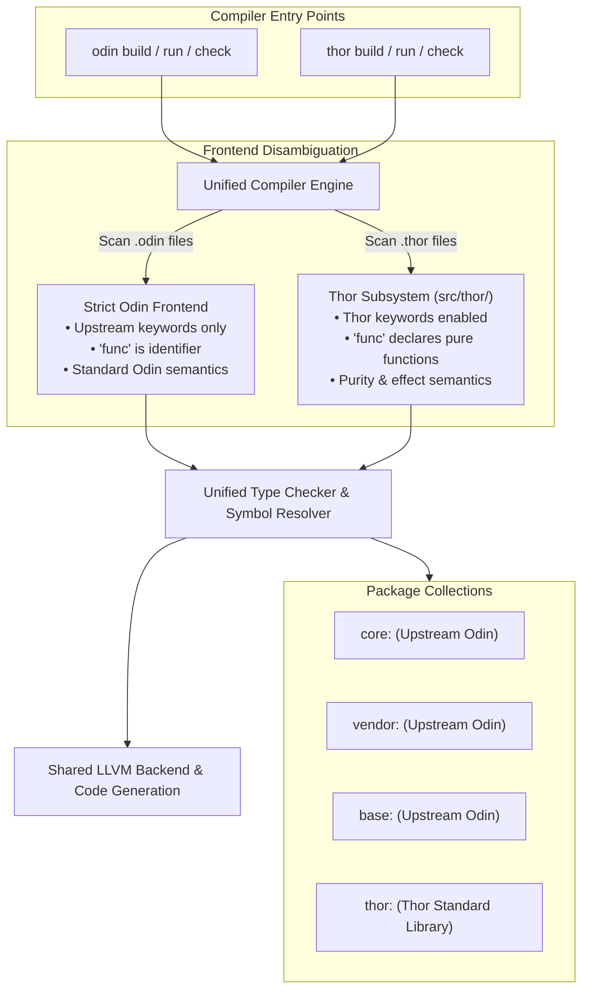

# Architectural Plan: Strict C/C++ Style Separation of Thor and Odin

## 1. Design Philosophy: The C / C++ Paradigm

In modern compiler infrastructure (such as GCC and Clang), C and C++ share a single unified compiler engine and LLVM backend, but maintain **strict, uncompromising language separation at the frontend**:
- A `.c` file is compiled under strict C rules. C++ keywords (`class`, `new`, `template`) are regular identifiers.
- A `.cpp` file is compiled under C++ rules with all modern extensions enabled.
- Both dialects interoperate seamlessly and share the same code generator, target metrics, linker, and optimization pipeline.

We apply this exact architecture to **Odin** and **Thor**:
- **`.odin` Files**: Compiled strictly according to upstream Odin specifications. Zero Thor keywords or rules are active. Upstream `core:` and `vendor:` remain 100% pristine.
- **`.thor` Files**: Compiled under Thor language rules. Thor keywords (`func`, etc.) and semantic validations (function purity, effect tracking) are active.
- **`thor:` Standard Library**: Thor receives its own top-level package collection alongside `core:` and `vendor:`.
- **Modular Subsystem (`src/thor/`)**: All Thor-specific frontend rules, keywords, and checkers are encapsulated in a dedicated directory rather than scattered across Odin's compiler files.



---

## 2. Technical Separation Architecture

### 2.1 File Extension Gating
| Feature | `.odin` Files | `.thor` Files |
|---|---|---|
| **Dialect** | Strict Vanilla Odin | Thor Language |
| **`func` Token** | `Token_Ident` (Normal identifier) | `Token_func` (Pure function keyword) |
| **Purity Semantics** | Inactive | Enforced (`contextless`, no global state, no impure calls) |
| **`import "thor:..."`** | Permitted (Interop) | Permitted (Native) |
| **Upstream Diff** | **0 lines diff** | Isolated Thor additions |

### 2.2 Compiler Source Code Modularization (`src/thor/`)
Rather than spreading `#if` checks and Thor logic throughout Odin's core compiler files (`parser.cpp`, `checker.cpp`, `check_expr.cpp`), Thor logic will be cleanly encapsulated into `src/thor/`:

1. **`src/thor/thor.hpp`**:
   - Dialect definitions and feature flags.
   - Keyword definitions for Thor.
   - Purity and effect rule prototypes.
2. **`src/thor/thor_checker.cpp`**:
   - Validation routines for Thor pure functions (`thor_check_pure_func`, `thor_check_call_in_pure_func`, `thor_check_global_access_in_pure_func`).
   - Clean API called from Odin's checker without cluttering Odin's core type check routines.
3. **`src/main.cpp` & `src/build_settings.cpp`**:
   - Clean registration of the `thor:` package root collection.
   - Unified driver dispatch for `odin` and `thor` CLI commands.

### 2.3 The `thor:` Package Collection
Register a first-class `thor:` library collection in `src/build_settings.cpp` and `src/main.cpp`:
- Located at `$ODIN_ROOT/thor`
- Accessible in both `.thor` and `.odin` files via:
  ```thor
  import "thor:math"
  import "thor:prelude"
  ```
- Leaves `core/` and `vendor/` completely reserved for upstream Odin.

---

## 3. Implementation Steps

1. **Modularize Thor Compiler Code**:
   - Create `src/thor/thor.hpp` and `src/thor/thor_checker.cpp`.
   - Move Thor purity checks and keyword definitions into `src/thor/`.
   - Update `src/main.cpp` to include `src/thor/thor.hpp`.
2. **Register the `thor:` Collection**:
   - Add `add_library_collection(str_lit("thor"), ...)` in `src/main.cpp`.
3. **Scaffold `thor/` Standard Library Root**:
   - Create top-level directory `thor/` with `thor/README.md`.
   - Add initial foundational modules (e.g. `thor/math` with pure functions).
4. **Verification & Testing**:
   - Test vanilla Odin: `examples/demo`, `core/c/libc`.
   - Test Thor: `tests/internal/test_pure_func.thor`.
   - Test Interoperability: `tests/thor_interop` importing `thor:math`.
5. **Documentation & Git Commit**:
   - Save report to `reports/done/thor_strict_separation_plan.md`.
   - Create a clean git commit.
